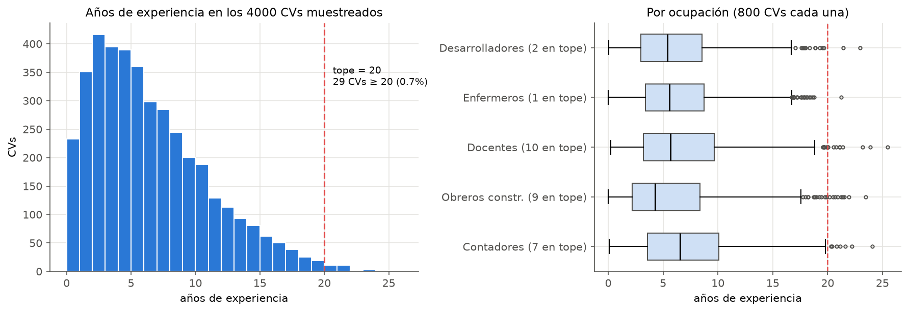
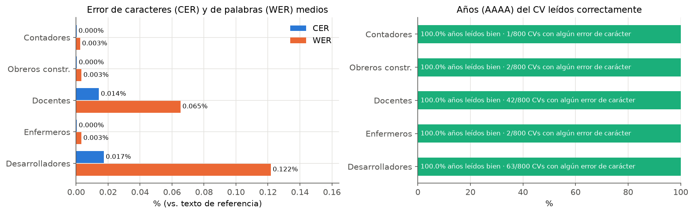
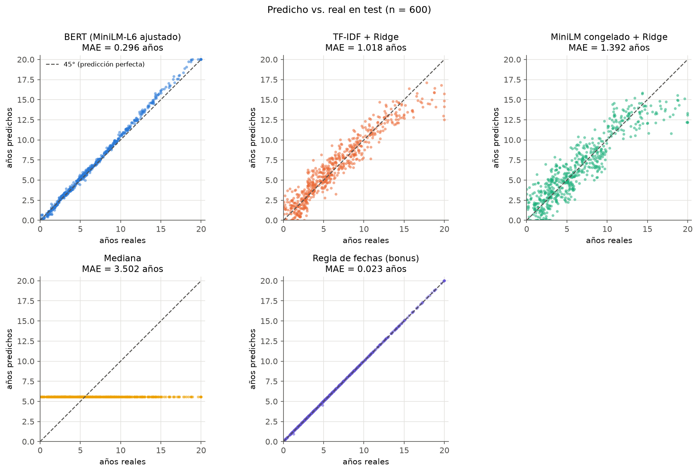
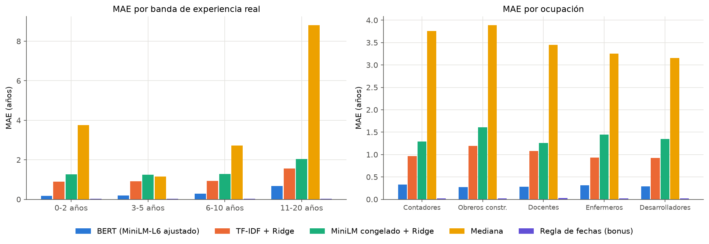
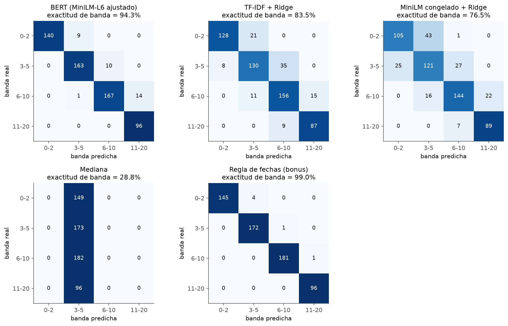
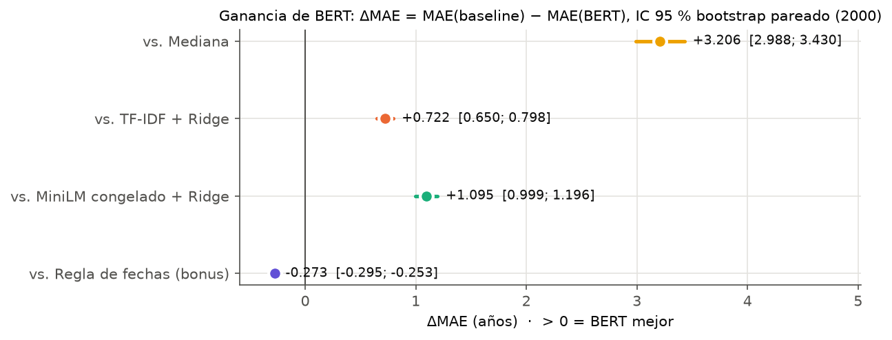
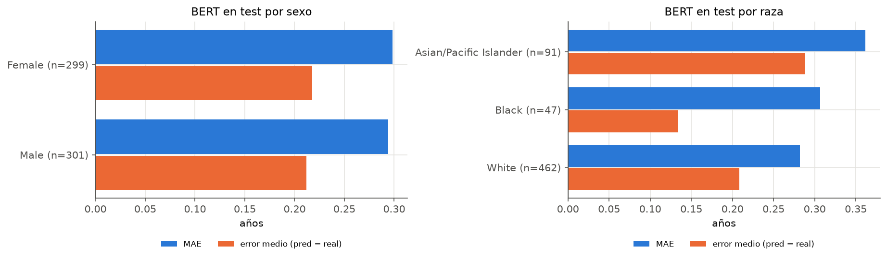

# cv_experience_ocr_bert — Tarea 3 (HW_04_202602)

Predicción de **años de experiencia laboral (0–20)** a partir de **imágenes de CVs** del dataset PopResume
(`sumin-yu/PopResume`): OCR con PaddleOCR → texto limpio → BERT ajustado como regresor, comparado con tres baselines
(mediana, TF-IDF + Ridge, embeddings congelados + Ridge) y una regla de fechas (bonus). Incluye un dashboard en Streamlit
con un estimador interactivo.

Todos los números de este documento salen de los archivos de `output/` (métricas, tablas y predicciones de la corrida real).

## Índice

1. [Qué hace y para quién](#1-qué-hace-y-para-quién)
2. [Muestreo y distribución de la variable objetivo](#2-muestreo-y-distribución-de-la-variable-objetivo)
3. [OCR y orden de lectura](#3-ocr-y-orden-de-lectura)
4. [Calidad del OCR](#4-calidad-del-ocr)
5. [Limpieza y CVs enmascarados](#5-limpieza-y-cvs-enmascarados)
6. [Split](#6-split)
7. [Baselines](#7-baselines)
8. [BERT y textos largos](#8-bert-y-textos-largos)
9. [Métricas finales y ganancia de BERT con IC](#9-métricas-finales-y-ganancia-de-bert-con-ic)
10. [Respuestas a las 4 preguntas analíticas](#10-respuestas-a-las-4-preguntas-analíticas)
11. [Limitaciones y usos de negocio](#11-limitaciones-y-usos-de-negocio)
12. [Reproducción paso a paso](#12-reproducción-paso-a-paso)
13. [Cómo correr la app](#13-cómo-correr-la-app)

## Estructura

```
app.py  README.md  requirements.txt
src/
  utils.py              constantes, rutas, semillas, bandas
  download_data.py      muestreo por streaming de PopResume                       (Persona 1)
  ocr_extraction.py     PaddleOCR + orden de lectura → data/ocr/{id}.json          (Persona 1)
  ocr_quality.py        CER, WER y exactitud de años                               (Persona 1)
  preprocessing.py      limpieza, PII y enmascarado → clean_texts.csv              (Persona 1)
  split.py              train/val/test estratificado                               (Persona 1)
  model_common.py       datos, métricas, predictores, perturbaciones               (Persona 2)
  baselines.py  train_bert.py  evaluation.py  analysis_questions.py                (Persona 2)
  visualization.py      figuras del informe/dashboard + equidad (Pregunta 4)       (Persona 3)
scripts/
  set_hf_token.py       guarda el token de Hugging Face en .env (oculto)
  fetch_demographics.py baja id + sexo + raza para la Pregunta 4                   (Persona 3)
data/raw/        imágenes, metadata.csv, reference_texts.csv, demographics.csv     (no se versiona)
data/ocr/        un JSON por CV (texto, cajas, confianza, tiempos)                 (no se versiona)
data/processed/  ocr_quality.csv, clean_texts.csv
data/splits/     train.csv, val.csv, test.csv   (id, occupation, exp_year, band)
models/baselines/  *.joblib                                                        (no se versiona)
models/bert/       pesos del BERT ajustado                                         (no se versiona)
output/figures/  output/tables/  output/metrics/  output/predictions/
```

---

## 1. Qué hace y para quién

Dado el CV de una persona en imagen (o PDF), el sistema estima **cuántos años de experiencia laboral tiene**, aunque el
CV no lo diga en ninguna frase: la información está en las fechas de su historial (`2019.12–2022.01`).

**Para quién:** equipos de reclutamiento y plataformas de empleo que reciben CVs escaneados o en PDF y necesitan
**pre-llenar** el campo «años de experiencia» de un perfil o **priorizar la revisión** humana. **No** está pensado para
filtrar candidatos automáticamente ni para decidir una contratación (ver [Pregunta 4](#pregunta-4--equidad-y-ética)).

## 2. Muestreo y distribución de la variable objetivo

* **Fuente:** PopResume, dataset **sintético** y **restringido (gated)** en Hugging Face.
* **Muestreo** (`src/download_data.py`): streaming por ocupación, solo `has_photo == False`,
  `shuffle(seed=42, buffer_size=5000)` y `take(800)`. La muestra es aleatoria dentro de la ventana del buffer (no sobre
  todo el parquet): es la consecuencia de usar streaming.
* **Tamaño:** 800 CVs por ocupación × 5 ocupaciones = **4000 CVs** (`accountants_auditors`, `construction_laborers`,
  `elementary_middle_school_teachers`, `registered_nurses`, `software_developers`).
* **Distribución** (`output/metrics/sampling_report.json`, figura `output/figures/exp_year_distribution.png`):
  `exp_year` es **continuo**, de 0,003 a 25,45 años; media 6,53; mediana 5,57.
* **Tope:** solo **29 CVs (0,73 %)** tienen 20 años o más (por ocupación: docentes 10, obreros 9, contadores 7,
  desarrolladores 2, enfermeros 1), muy por debajo del 15 % que obligaría a replantearlo: **el tope de 20 se mantiene**
  y los modelos recortan sus predicciones a [0, 20].



## 3. OCR y orden de lectura

* **Motor:** PaddleOCR 3.7.0 / PaddlePaddle 3.3.1, perfil por defecto (PP-OCRv6 medium), `lang="en"`, sin
  clasificador de orientación ni *unwarping*. Solo CPU (Apple M2, 8 GB). 4000/4000 CVs procesados, **0 fallidos**.
* **Tiempo:** 122 306 s de OCR en total (tres procesos en paralelo), **30,6 s por CV** de media (mediana 29,9 s).
  Confianza media 0,9953; 14,4 líneas por CV (`output/metrics/ocr_report.json`).
* **Salida:** un JSON por CV en `data/ocr/{id}.json` con `lines` (texto, confianza, caja `[x1, y1, x2, y2]`, fila),
  `full_text`, `mean_confidence`, `ocr_time_seconds` e `image_size`.
* **Orden de lectura** (`reading_order` en `src/ocr_extraction.py`): las cajas se ordenan por su centro vertical; dos
  cajas cuyo centro difiere menos de **15 px** pertenecen a la misma fila y se leen de izquierda a derecha. Las cajas de
  una fila se unen con espacio y las filas con salto de línea. Así un layout de dos columnas se recorre fila por fila.

## 4. Calidad del OCR

Comparación contra el texto de referencia del dataset, con ambos textos normalizados (minúsculas, sin puntuación)
(`output/metrics/ocr_quality.json`, `output/tables/ocr_quality_summary.csv`):

| Métrica | Media | Mediana | p90 | Máx. |
|---|---|---|---|---|
| CER | 0,0001 | 0 | 0 | 0,0075 |
| WER | 0,0004 | 0 | 0 | 0,0222 |

* **Años leídos bien: 100 %** (24 429 años AAAA en la referencia).
* **Por ocupación** (`output/figures/ocr_quality_by_occupation.png`): los pocos CVs con algún error de carácter se
  concentran en desarrolladores (63/800; CER medio 0,017 %, WER 0,122 %) y docentes (42/800; CER 0,014 %, WER 0,065 %);
  las otras tres ocupaciones tienen 1–2 CVs con error.
* El OCR es casi perfecto porque PopResume son plantillas limpias de una columna. Única falla relevante: en **13 CVs**
  el OCR cortó el mes final de la última fecha (`2020.02–2023.` en lugar de `2020.02–2023.01`).



## 5. Limpieza y CVs enmascarados

`src/preprocessing.py` → `data/processed/clean_texts.csv` (`id, clean_text, was_masked`), reporte en
`output/metrics/preprocessing_report.json`:

1. **Umbral de confianza 0,5** por línea. Ninguna línea tiene confianza menor a 0,95, así que no descarta nada y queda
   como red de seguridad. Subirlo borra texto correcto: CER 0,0001 → 0,0018 con 0,97, 0,026 con 0,98 y 0,21 con 0,99
   (`output/tables/confidence_threshold_analysis.csv`).
2. Unión de líneas rotas y palabras partidas; normalización del separador de los rangos de fechas.
3. **PII:** se elimina el bloque de cabecera (nombre, «ST, USA | teléfono | email») y cualquier email, teléfono, URL o
   dirección restante. Tras limpiar no queda ningún email, teléfono ni URL.
4. **Enmascarado** con `[MASKED]` de «X years of experience», «X+ years», variantes en palabras, edad y fecha de
   nacimiento. **Las fechas de empleo y graduación no se tocan** (ningún CV perdió un año al limpiar).

**CVs enmascarados: 0 de 4000 (0 %).** Se leyeron textos OCR completos (más de 25 en detalle y unos 280 con revisión
automática) y luego se escanearon los 4000: PopResume no contiene frases de «years of experience», edad ni fecha de
nacimiento, así que no hubo nada que tapar (`output/tables/masking_examples.csv` queda vacío). Los patrones siguen
activos por si se usa otro dataset; el estimador de la app avisa si enmascara algo.

## 6. Split

`src/split.py` → `data/splits/{train,val,test}.csv`: **2800 / 600 / 600** (70/15/15), estratificado por ocupación ×
banda (0-2, 3-5, 6-10, 11-20), semilla 42. Diferencia máxima entre conjuntos: 0,33 puntos porcentuales por banda, 0,20
por ocupación y 0,17 por celda ocupación × banda (`output/tables/split_balance.csv`). `exp_year` medio:
6,519 / 6,553 / 6,533. Todos los modelos se entrenan solo con train, eligen hiperparámetros con val y se miden **una
vez** en test.

## 7. Baselines

`src/baselines.py` (búsqueda de α en `output/tables/baselines_val_search.csv`):

| Modelo | Detalle |
|---|---|
| Mediana | mediana de train (5,54 años) |
| TF-IDF + Ridge | 1-2 gramas de palabras, `sublinear_tf`, `min_df=2`, α = 0,1. **Se conservan números y años**: val MAE 0,969 con ellos vs. 1,671 sin ellos |
| MiniLM congelado + Ridge | `all-MiniLM-L6-v2` normalizado + Ridge (α = 0,03). Texto largo: trozos de líneas completas de ≤ 200 tokens promediados (en la práctica 1 trozo: el CV más largo mide 161 tokens) |
| Regla de fechas (bonus) | suma de las duraciones de los rangos `AAAA.MM–AAAA.MM`; variantes en val: `sum` y `union` 0,021, `span` 0,749 → `sum` |

## 8. BERT y textos largos

`src/train_bert.py`: **`sentence-transformers/all-MiniLM-L6-v2`** (arquitectura BERT, 6 capas, 22,7 M de parámetros)
con `num_labels=1`, pérdida **MSE**, target escalado `y/20`, predicción desescalada y recortada a [0, 20].

* **Hiperparámetros:** AdamW, lr 1e-4, weight decay 0,01, calentamiento 10 % y decaimiento lineal, batch 16, hasta 12
  épocas, `max_len=256`, early stopping (paciencia 4) sobre el MAE de val en años, semilla 42.
* **Hardware y tiempo:** Intel Core i5-10210U (4 hilos), sin GPU; mediana de 534 s por época, ~1,8 h efectivas. Se
  probó DistilBERT y era demasiado lento en CPU.
* **Mejor época: la 12 (la última)**, val MAE 0,298: el early stopping no llegó a activarse; con más épocas podría
  mejorar algo (no se probó).
* **Textos largos:** media 97 tokens, máximo 161; con `max_len=256` **0 % de los CVs se trunca**, por lo que `head`,
  `head_tail` y *chunking* dan exactamente lo mismo. Se usa `head`. En una prueba de estrés con topes artificiales
  (96 y 64 tokens), `head` se degrada más despacio que `head_tail` (0,344 vs. 1,445 con 96 tokens), porque los empleos
  recientes están arriba.

## 9. Métricas finales y ganancia de BERT con IC

Test, n = 600 (`output/tables/model_comparison.csv`):

| Modelo | MAE | RMSE | ±1 año | ±2 | ±3 | Acc. bandas | F1 macro | R² | Sesgo (pred − real) |
|---|---|---|---|---|---|---|---|---|---|
| Mediana | 3,502 | 4,536 | 19,2 % | 34,0 % | 51,7 % | 28,8 % | 0,112 | −0,049 | −0,983 |
| TF-IDF + Ridge | 1,018 | 1,361 | 57,8 % | 88,5 % | 96,8 % | 83,5 % | 0,843 | 0,906 | +0,014 |
| MiniLM congelado + Ridge | 1,392 | 1,828 | 45,2 % | 76,3 % | 91,7 % | 76,5 % | 0,774 | 0,830 | −0,049 |
| **BERT (MiniLM-L6 ajustado)** | **0,296** | **0,393** | **97,5 %** | **100 %** | **100 %** | **94,3 %** | **0,943** | **0,992** | +0,215 |
| Regla de fechas (bonus) | 0,023 | 0,033 | 100 % | 100 % | 100 % | 99,0 % | 0,990 | 1,000 | −0,002 |

**Ganancia de BERT** (bootstrap pareado, 2000 remuestreos; ΔMAE = MAE baseline − MAE BERT; Δ > 0 = BERT mejor;
`output/tables/bootstrap_bert_vs_baselines.csv`):

| Frente a | ΔMAE | IC 95 % |
|---|---|---|
| Mediana | +3,206 | [2,988; 3,430] |
| TF-IDF + Ridge | +0,722 | [0,650; 0,798] |
| MiniLM congelado + Ridge | +1,095 | [0,999; 1,196] |
| Regla de fechas (bonus) | **−0,273** | [−0,295; −0,253] |

BERT supera de forma significativa a los tres baselines aprendidos, pero **la regla de fechas lo supera a él**: en
PopResume `exp_year` es prácticamente la suma de las duraciones de los empleos y la regla la calcula de forma explícita.

**MAE por banda real:** BERT 0,180 / 0,191 / 0,289 / 0,678 (0-2 / 3-5 / 6-10 / 11-20) frente a TF-IDF 0,903 / 0,908 /
0,933 / 1,559. **Por ocupación** el MAE de BERT es parejo (0,27–0,33). **Matriz de confusión:** BERT acierta la banda en
el 94,3 % y sus 34 errores caen todos en la banda vecina, 33 de ellos hacia arriba (sobrestima levemente).






**Mayores errores de BERT** (`output/tables/bert_top10_errors.csv`): los 10 son sobrestimaciones de 1,1 a 1,4 años en
CVs con **4 empleos y 12–19 años** (banda 11-20, la más escasa en train); 5 tienen huecos de carrera y 5 son errores de
aritmética sin causa de OCR. Ninguno se debe a fechas mal leídas, orden de lectura ni truncamiento. En todo test el MAE
de BERT crece con el número de empleos (0,18 con 1 empleo, 0,19 con 2, 0,26 con 3, 0,64 con 4) y con los huecos
(0,37 con huecos vs. 0,25 sin ellos).

## 10. Respuestas a las 4 preguntas analíticas

### Pregunta 1 — ¿Qué aprende BERT que los baselines no?

BERT baja el MAE de 1,018 (TF-IDF) a **0,296** (−71 %) y ayuda en todas las bandas, sobre todo en 11-20 (0,68 vs. 1,56).
La **prueba de perturbación** (`output/tables/q1_perturbation.csv`, 20 CVs de test con ≥ 2 empleos y una muestra de 200
para confirmar) muestra qué aprendió:

| Modelo (20 CVs) | Cambio medio con fechas +5 años | Pendiente al borrar un empleo | Correlación |
|---|---|---|---|
| TF-IDF + Ridge | 1,99 años | −0,55 | −0,67 |
| MiniLM + Ridge | 0,78 años | 1,04 | 0,65 |
| **BERT** | **2,41 años** | **−0,01** | **−0,01** |
| Regla de fechas | 0,00 | 1,00 | 1,00 |

Al desplazar todas las fechas 5 años (la duración real no cambia), BERT cambia su respuesta ~2,4 años; al borrar un
empleo su predicción casi no se mueve (debería bajar ~2,8 años). **BERT no resta fechas: aprendió a reconocer años
absolutos** (todos los CVs terminan en 2023.01). Por eso gana a TF-IDF pero queda lejos de la regla, y no se
generalizaría a CVs con otra fecha de corte.

### Pregunta 2 — ¿Cuánto cuesta el ruido del OCR?

Se evaluó cada modelo sobre el texto OCR y sobre el texto de referencia limpiado igual (`output/tables/q2_ocr_noise.csv`).
**El ruido real de caracteres cuesta prácticamente nada** (≤ 0,003 años en todos los modelos; solo 14 de 600 CVs de
test tienen CER > 0). Lo que sí pesa es el **formato**: el MAE de BERT sube de 0,296 a 0,358 si solo cambian viñetas y
saltos de línea, porque se entrenó con el estilo exacto del OCR. TF-IDF y la mediana son robustos al formato; la regla de
fechas es la única afectada por ruido real (+0,0012 años, por las fechas truncadas).

### Pregunta 3 — Sensibilidad metodológica

`output/tables/q3_sensitivity.csv`:

* **Números en TF-IDF:** quitarlos empeora el MAE 75 % (1,018 → 1,782): los años son casi toda la señal.
* **Limpieza:** texto crudo con cabecera → TF-IDF 1,084, BERT 1,750 (sin reentrenar); umbral de confianza 0,99 → la
  regla pasa de 0,023 a 1,872 y BERT a 1,168, porque se borran líneas correctas. Se mantiene el umbral 0,5.
* **Texto largo:** sin efecto en los CVs reales; con topes artificiales `head` > `head_tail`.
* **MSE vs. Huber:** no se entrenó la variante Huber (`--loss huber` está implementado; ~2 h en CPU). Limitación.

### Pregunta 4 — Equidad y ética

**Usuarios posibles y para qué.** Reclutadores y plataformas de empleo, para **pre-llenar** perfiles o **ordenar la cola
de revisión** humana. Nunca para filtrar automáticamente ni decidir una contratación: la estimación es un apoyo que una
persona confirma.

**Costo de los errores.** Un error de **±2 años** rara vez cambia el tramo de un puesto y se corrige al revisar; uno de
**±5 años** cambia de categoría (junior ↔ senior) y puede excluir a alguien o fijarle un salario equivocado.
**Subestimar es peor** para el candidato: puede quedar fuera de la lista corta sin que nadie lo revise; sobrestimar se
detecta en la entrevista, aunque crea expectativas falsas. BERT sobrestima levemente (sesgo +0,21 años) y ningún error
en test supera ±2 años.

**Resultados de equidad.** MAE y error medio (predicho − real) de BERT en los 600 CVs de test, por sexo y por raza,
unidos por `id` con las columnas `sex` y `race` de PopResume (`scripts/fetch_demographics.py`: los 4000 ids se unieron
y `exp_year` coincide en todos). Sexo y raza **nunca** son features: solo se usan después de predecir. Tablas:
`output/tables/fairness_by_sex.csv` y `output/tables/fairness_by_race.csv`; figura `output/figures/fairness_bert.png`.

| Grupo | n | MAE | Error medio (pred − real) | Años reales medios |
|---|---|---|---|---|
| Female | 299 | 0,299 | +0,218 | 6,85 |
| Male | 301 | 0,294 | +0,212 | 6,21 |
| Asian/Pacific Islander | 91 | **0,361** | **+0,288** | 7,47 |
| Black | 47 | 0,307 | +0,134 | 6,62 |
| White | 462 | 0,282 | +0,208 | 6,33 |
| **Total** | 600 | 0,296 | +0,215 | 6,53 |

IC 95 % por bootstrap de la diferencia entre grupos (2000 remuestreos, semilla 42; cálculo hecho para este análisis y no
guardado como tabla):

* **Sexo: no hay diferencia.** ΔMAE mujeres − hombres = +0,005 años, IC [−0,039; 0,048]; Δ error medio +0,006,
  IC [−0,047; 0,056]. Ambos grupos se **sobrestiman** lo mismo (~+0,21 años, unos 2,6 meses).
* **Raza: el grupo Asian/Pacific Islander tiene más error.** Su MAE supera al del grupo White en **+0,079 años
  (~1 mes)**, IC [0,016; 0,147]: es la única diferencia significativa. También es el grupo **más sobrestimado**
  (+0,288 vs. +0,208; Δ +0,080, IC [−0,003; 0,163], en el límite de la significancia).
* El grupo **Black es el menos sobrestimado** (+0,134), con un MAE parecido al de White (Δ +0,025, IC [−0,049; 0,099]).
  Pero con n = 47 la estimación es poco estable.
* **Ningún grupo se subestima en promedio.** BERT sobrestima a todos; solo subestima levemente en la banda 0-2
  (−0,06 en mujeres, −0,04 en hombres). Todas las diferencias son de semanas a ~1 mes, muy por debajo del umbral de
  ±2 años que cambiaría una decisión.



**Posibles causas, aunque sexo y raza no sean entradas.** El texto contiene **proxies** que se relacionan con el grupo
y con el error:

* El error de BERT crece con la experiencia y el número de empleos (MAE 0,18 con 1 empleo y 0,64 con 4) y con los huecos
  de carrera (0,37 vs. 0,25).
* En test, el grupo Asian/Pacific Islander tiene más CVs en la banda 11-20 (25 % vs. 14 % en White), más empleos
  (2,65 vs. 2,37), algo más de huecos (43 % vs. 39 %) y un 54 % son desarrolladores de software (15 % en White).
* Dentro de cada banda su MAE es parecido al de White: 0,20 / 0,19 / 0,33 / 0,72 frente a 0,17 / 0,19 / 0,28 / 0,68.
  Si se reponderan sus bandas con la distribución de White, su MAE baja de 0,361 a ~0,310. Así, **cerca de dos tercios (~65 %) de la
  brecha se explica por la composición** (más CVs largos y senior) y el resto por un error algo mayor en 6-10 y 11-20.
* La brecha no viene de que el modelo «vea» la raza, sino de que el tipo de CV en el que BERT falla más (4 empleos,
  muchos años, huecos) es más frecuente en ese grupo. Un modelo con aritmética de fechas real (la regla) no mostraría
  ese patrón.

Igual hay que repetir esta auditoría con datos reales antes de cualquier uso: allí los proxies (nombres, universidades,
huecos por cuidado de hijos) pueden pesar mucho más que en un dataset sintético. Por eso la auditoría por grupo
es obligatoria antes de cualquier uso.

**Limitaciones.** Datos **sintéticos**, solo **5 ocupaciones**, población de **EE. UU.** y CVs **solo en inglés**, con
plantillas limpias de una columna y una fecha de corte común (2023.01).

## 11. Limitaciones y usos de negocio

**Limitaciones**

* Dataset sintético con plantillas limpias: el OCR es casi perfecto y no representa CVs reales escaneados, fotos de
  baja calidad ni layouts complejos.
* 5 ocupaciones, EE. UU., solo inglés, fechas en formato `AAAA.MM–AAAA.MM` y una fecha de corte común (2023.01).
* BERT no aprendió aritmética de fechas (Pregunta 1) y es sensible al formato del texto (Pregunta 2); una regla
  explícita es mucho mejor en este dataset.
* No se entrenó la variante Huber ni más de 12 épocas; no se reentrenó BERT con cada variante de limpieza.
* La auditoría de equidad usa grupos chicos en test (Black n = 47, Asian/Pacific Islander n = 91), así que los IC son anchos. Además, la muestra de 4000 CVs solo trae tres categorías de raza (White 3107, Asian/Pacific Islander 616, Black 277) y sexo binario (Female 2031, Male 1969).

**Usos de negocio**

* **Pre-llenado de perfiles** en portales de empleo a partir de CVs subidos en imagen o PDF, con confirmación del
  candidato.
* **Priorización** de la cola de revisión de un reclutador (p. ej. mostrar primero perfiles que encajan con el tramo de
  experiencia del puesto), siempre con revisión humana y sin descartes automáticos.
* **Control de calidad** de datos de RR. HH.: marcar perfiles donde la experiencia declarada difiere mucho de la estimada.
* En producción convendría combinar BERT con la regla de fechas (respaldo cuando las fechas son legibles) y monitorear
  el error por grupo.

## 12. Reproducción paso a paso

### Entorno

```bash
conda create -n tarea3 python=3.12 && conda activate tarea3      # o: uv venv --python 3.12 .venv
pip install paddlepaddle==3.3.1          # primero Paddle (paddlepaddle-gpu si hay GPU NVIDIA)…
pip install -r requirements.txt          # …luego el resto
```

PopResume es **restringido**: aceptar las condiciones en <https://huggingface.co/datasets/sumin-yu/PopResume>, crear un
token de lectura y guardarlo con `python scripts/set_hf_token.py` (queda en `.env`, ignorado por git).

### Pipeline (desde `Tarea 3/`, en este orden)

```bash
python -m src.download_data            # 800 CVs sin foto por ocupación → data/raw/
python -m src.ocr_extraction           # data/ocr/{id}.json (reanudable; --shard k/n para paralelizar)
python -m src.ocr_quality              # CER, WER, años → data/processed/ocr_quality.csv
python -m src.preprocessing            # → data/processed/clean_texts.csv
python -m src.split                    # → data/splits/{train,val,test}.csv
python -m src.baselines                # → models/baselines/*.joblib, output/predictions/
python -m src.train_bert --model sentence-transformers/all-MiniLM-L6-v2 --epochs 12 --patience 4 --lr 1e-4 --tag minilm-l6_mse
python -m src.evaluation --bert-tag minilm-l6_mse
python -m src.analysis_questions --bert-tag minilm-l6_mse        # Preguntas 1, 2 y 3
python scripts/fetch_demographics.py   # sexo y raza (solo para auditar, Pregunta 4)
python -m src.visualization            # figuras en output/figures/ + fairness_by_{sex,race}.csv
```

`data/raw/` y `data/ocr/` no están en git (se comparten aparte en un zip). Sí están en git `data/splits/*.csv`,
`data/processed/*.csv` y todo `output/`, así que `python -m src.visualization` y la app funcionan sin repetir el OCR.

### Pesos de los modelos (no están en el repositorio)

Los pesos **no se suben a git** (`.gitignore` excluye `models/**`, `*.safetensors`, `*.bin`, `*.pt`, `*.joblib`).

* **BERT:** colocar los archivos del modelo ajustado (`config.json`, `model.safetensors`, `tokenizer.json`,
  `tokenizer_config.json`, `special_tokens_map.json`, `vocab.txt`) en **`models/bert/`** (o en
  `models/bert/minilm-l6_mse/`, que es donde los deja `src.train_bert`). Para regenerarlos, correr el comando
  `python -m src.train_bert …` de arriba (~1,8 h en CPU de 4 hilos). Con los pesos de la corrida real, las predicciones
  de test coinciden con `output/predictions/bert_minilm-l6_mse__ocr.csv` (diferencia máxima 5e-6 años).
* **Baselines:** `python -m src.baselines` los regenera en `models/baselines/`. Si faltan, la app reentrena la mediana y
  TF-IDF con train al arrancar (segundos) usando el mismo α elegido en val, y ofrece reentrenar MiniLM + Ridge (~4 min).

## 13. Cómo correr la app

```bash
streamlit run app.py
```

Cuatro pestañas:

1. **Problema y metodología.**
2. **OCR y análisis exploratorio:** distribución de `exp_year`, calidad del OCR por ocupación, CV de ejemplo con las
   cajas de PaddleOCR (si hay imágenes o JSON locales), limpieza y split.
3. **Resultados de modelos:** tabla comparativa, dispersión predicho vs. real con selector de modelo, MAE por banda y
   ocupación, matrices de confusión, ganancia de BERT con IC 95 %, sensibilidad (Pregunta 3), equidad (Pregunta 4) y
   respuestas a las 4 preguntas.
4. **Estimador interactivo:** subir una imagen (PNG/JPG) o un PDF → PaddleOCR → texto limpio (misma limpieza del
   pipeline) → predicción de cada modelo disponible. Incluye un explorador de los CVs de test (por ocupación, años reales
   y tamaño del error) y ejemplos de aciertos y errores.

La app no se rompe si falta algún archivo: muestra un aviso en esa sección y sigue. En Windows con CPU, PaddlePaddle 3.3
falla con oneDNN; la app crea PaddleOCR con la misma configuración y `enable_mkldnn=False`. El OCR tarda ~30 s por CV en
CPU (la primera vez descarga los modelos de PaddleOCR).

`.streamlit/config.toml` desactiva el *file watcher* de Streamlit (`fileWatcherType = "none"`). Ese watcher recorre
todos los módulos cargados y, con los módulos «lazy» de transformers, fuerza imports opcionales (p. ej. `zoedepth` →
`torchvision`) que llenan la terminal de `ModuleNotFoundError` y frenan la app. Consecuencia: tras editar el código hay
que detener y volver a lanzar `streamlit run app.py` (no se recarga sola).
