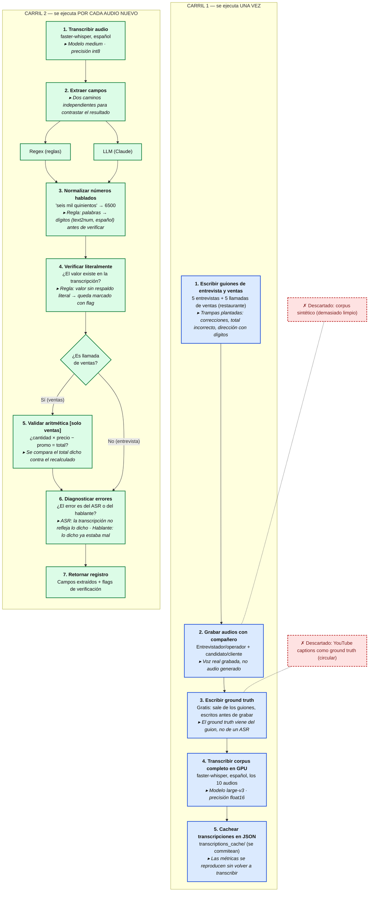

# Pipeline — versión Mermaid

Mismo diagrama que `pipeline_diagram.png` (generado con `pipeline_diagram.py`), en texto. Azul = carril 1 (una vez), verde = carril 2 (por cada audio nuevo), rojo punteado = descartado.

